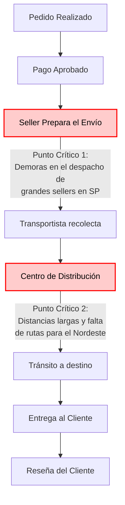
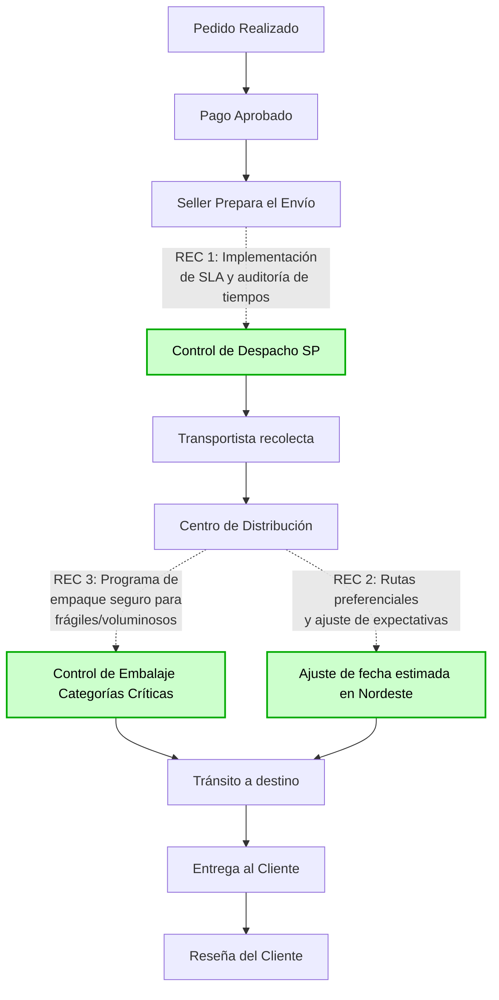

# Modelo de Proceso de Negocio: AS-IS / TO-BE

Este documento modela el proceso logístico actual de Olist (AS-IS) e identifica los puntos críticos donde se originan los retrasos. A partir de ellos, se propone un proceso optimizado (TO-BE) basado en las recomendaciones del análisis de datos.

## 1. Proceso Actual (AS-IS)

El siguiente diagrama muestra el flujo estándar de un pedido y resalta los dos puntos críticos donde nuestro análisis detectó que se originan la mayoría de los retrasos.

**Análisis de los Puntos Críticos:**
1. **Despacho del Seller (SP):** Los vendedores de São Paulo (que tienen el mayor volumen de ventas) tardan más de lo esperado en entregar el paquete al transportista, generando un cuello de botella inicial.
2. **Tránsito al Nordeste:** Una vez en el centro de distribución, los envíos hacia los estados de AL, MA, PI, CE y SE enfrentan demoras significativas debido a la lejanía y a las limitaciones de la red logística actual.

---

## 2. Proceso Propuesto (TO-BE)

El siguiente diagrama muestra cómo se transforma el proceso al implementar las recomendaciones accionables derivadas del análisis de datos.

**Mejoras Implementadas (Conectadas a las Recomendaciones):**
- **Recomendación 1 (Control de Despacho):** Se añade un paso de control de SLA para los grandes sellers de SP, asegurando que el paquete llegue al transportista en el tiempo acordado.
- **Recomendación 2 (Tránsito Nordeste):** Se renegocian rutas preferenciales para el Nordeste y, crucialmente, se ajustan los plazos estimados en la plataforma para que el cliente no perciba un "retraso" (aunque el tiempo físico sea el mismo).
- **Recomendación 3 (Embalaje):** Se agrega un control de embalaje especializado para categorías como muebles de oficina y electrónica, evitando daños en tránsito y mejorando la reseña del producto.